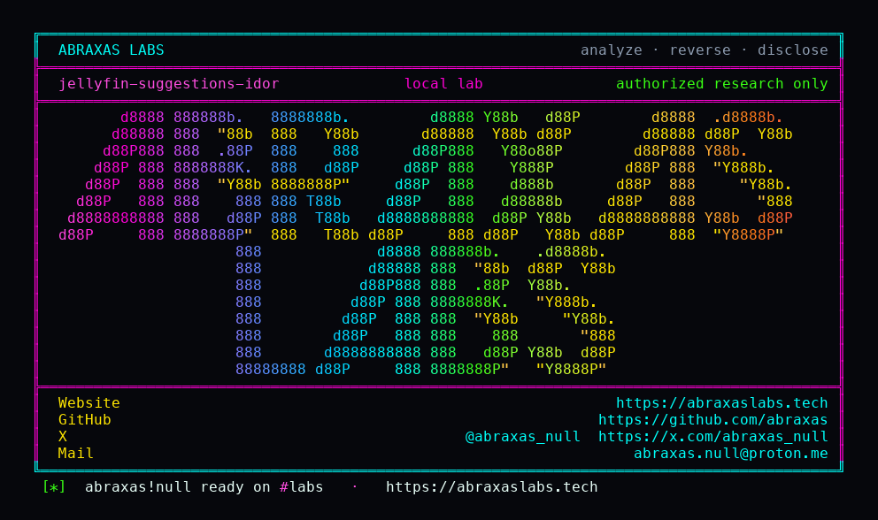

<p align="center">
  
</p>

<p align="center">
  <a href="https://abraxaslabs.tech"><strong>abraxaslabs.tech</strong></a>
  &nbsp;·&nbsp;
  <a href="https://github.com/abraxas">github.com/abraxas</a>
  &nbsp;·&nbsp;
  <a href="https://x.com/abraxas_null">@abraxas_null</a>
  &nbsp;·&nbsp;
  <a href="mailto:abraxas.null@proton.me">abraxas.null@proton.me</a>
  &nbsp;·&nbsp;
  <a href="https://github.com/abraxas/jellyfin-suggestions-idor">jellyfin-suggestions-idor</a>
</p>

# jellyfin-suggestions-idor

**Jellyfin Server** `12.2` - Jellyfin

**Class:** IDOR. **Reach:** Remote (any authenticated non-admin).

[`GET /Items/Suggestions`](https://github.com/jellyfin/jellyfin/blob/v12.2/Jellyfin.Api/Controllers/SuggestionsController.cs) is `[Authorize]` only. When `userId` is omitted, `SuggestionsController.GetSuggestions` sets `user = null` and never calls `RequestHelpers.GetUserId`. `InternalItemsQuery(null)` does not `SetUser`. `LibraryManager.GetItemsResult` skips `AddUserToQuery`. `new DtoOptions()` includes `ItemFields.Path`. `GetBaseItemDtos(..., user: null)` skips `IsVisible`.

[GHSA-9x85](https://github.com/jellyfin/jellyfin/security/advisories/GHSA-9x85-gx46-6522) taught `GetUserId` (omit goes to claims; a foreign GUID is 403). `ItemsController.GetItems` always uses it. Suggestions did not. Legacy `GET /Users/{userId}/Suggestions` always has a route GUID, so that sibling does go through `GetUserId`.

**A restricted account dumps titles, IDs, overviews, provider IDs, and filesystem Path for libraries it is not assigned. Those GUIDs play on unauth `GET /Videos/{id}/stream`.**

| | |
|---|---|
| ID | no CVE yet |
| CWE | [CWE-639](https://cwe.mitre.org/data/definitions/639.html) / [CWE-862](https://cwe.mitre.org/data/definitions/862.html) |
| CVSS | **High: 6.5** `CVSS:3.1/AV:N/AC:L/PR:L/UI:N/S:U/C:H/I:N/A:N` |
| Product | [Jellyfin Server](https://github.com/jellyfin/jellyfin) |
| Affected | **v12.2** (`ca0f16eb7c195f720a1493ed469a27c4657db0c6`), image `jellyfin/jellyfin:12.2` |
| Auth | authenticated (any non-admin, including a child / hidden-library account) |
| License | [GNU Affero GPL v3.0](LICENSE) |
| Lab | `127.0.0.1:18790` only |

Leftover #1 of [Jellyfin 12.2 leftovers](https://abraxaslabs.tech/research/jellyfin-12.2-leftovers). Same pin, other packs: [jellyfin-svg-gzip](https://github.com/abraxas/jellyfin-svg-gzip) (GHSA-cf3c leftover gzip `data:image/png`), [jellyfin-playlist-itemids](https://github.com/abraxas/jellyfin-playlist-itemids) (GHSA-9x85 leftover `ItemIds` + unauth stream), [jellyfin-ffmpeg-colonslash](https://github.com/abraxas/jellyfin-ffmpeg-colonslash) (GHSA-wwwm leftover `.strm` URL quotes). This pack is the one that dumps the hidden library.

## What an attacker can do

Any authenticated non-admin, including a child / hidden-library / `MaxParentalRating` account. Needs a normal user token. No admin, no API key. They do not change passwords. They do not mint admin. They inventory libraries they were not assigned, including filesystem Path, then play those GUIDs.

Privilege table (exhaustive). Same bar as [Signal-Server Dropwizard admin](https://abraxaslabs.tech/research/signal-server-dropwizard-admin): method + path, what that call grants, recon vs integrity vs availability, lab-proven vs inferred, adjacent surface that stays closed.

| Axis | Method + path | Grants | Provenance |
|---|---|---|---|
| Recon | `GET /Items/Suggestions` with no `userId` (optional `limit` / `mediaType` / `type`) | Unscoped recursive item list: Name, Id, Overview, provider IDs, **filesystem Path**, image metadata of libraries the caller is not assigned, including folders given only to a hidden user. Folder ACL, parental rating, and allowed-tags are not applied. | **Lab-proven.** Restricted `labuser` (`EnableAllFolders=false`, `EnabledFolders=PublicB` only): `GET /Items` witness=0; Suggestions witness=1 |
| Recon | Same with `limit` omitted | `InternalItemsQuery.Limit` stays unset; the repository returns the full match set (entire item table, random order) | Source (`SuggestionsController.cs:70-95`) |
| Recon | unauth `GET /Videos/{itemId}/stream` with a GUID from that list | Bytes of that file as the jellyfin UID | Source (VideosController has no class `[Authorize]`; `StreamingHelpers` `GetItemById` without a user). Stream labbed in sibling leftover [jellyfin-playlist-itemids](https://github.com/abraxas/jellyfin-playlist-itemids), not this pack |
| Integrity | none on Suggestions | No password, policy, favorite, or session write | Closed |
| Availability | none on Suggestions | No DoS beyond ordinary query cost | Closed |

**Stays closed on this pin**

| Axis | Method + path | Why it is closed |
|---|---|---|
| Recon | `GET /Items?userId=` and `GET /Items?parentId=<hiddenFolder>` | Always `GetUserId` + `IsVisible` (`ItemsController.cs:265, 342-350`) |
| Recon | `GET /Playlists/{id}/Items?userId=` | `GetUserId` (`PlaylistsController.cs:524`). GHSA-9x85 class, patched |
| Recon | `GET /Items/Suggestions?userId=<other>` | Foreign GUID still hits `GetUserId` and **403**s for a non-admin. Lab-proven (`impersonate-403=yes`) |
| Recon | legacy `GET /Users/{userId}/Suggestions` | Route GUID is required, so it **does** call `GetUserId` |
| Integrity | `POST /Users/Password?userId=` | `AssertCanUpdateUser` |
| Integrity | `POST /Users/{id}/Policy` | `RequiresElevation` |
| Integrity | devices, sessions, `AddAdditionalUser` | elevation or own-session only |
| Recon | `GET /Users` / `GET /Users/{id}` | UserDto + policy (folder GUIDs, admin bit), not library contents or hashes. Household enum, not this leftover |

I am not claiming plugin-DLL RCE, a reverse shell, or password theft. The dump is the catalog (and Path) of libraries the caller was not assigned. The stream-by-GUID follow-on is longstanding Jellyfin HTML5/DLNA behavior; this leftover is what enumerates the IDs.

## How I found it

v12.2 closed the 12.0 GHSA wave. I sat on that tag anyway and read every `userId` query next to `RequestHelpers.GetUserId`. Items always uses it. Suggestions branches: empty `userId` -> `user = null`, never `GetUserId`. That is the leftover.

`run.sh` seeds two movie libraries (PrivateA named with the witness, PublicB), finishes the wizard, creates `labuser` with `EnableAllFolders=false` and `EnabledFolders=PublicB` only, then compares `GET /Items` against `GET /Items/Suggestions`.

Wrong turns already recorded: treating `GET /Items` as the leak (it is scoped); treating `Suggestions?userId=<admin>` as the leak (403); treating the legacy `/Users/{userId}/Suggestions` route as the hole (it has a GUID so it calls `GetUserId`); claiming unauth stream as this pack's bug (sibling leftover); a reverse shell. Theatre.

Client bugs look like product bugs. A helper that shadows `http.client` never sends a packet. `.recv()` on an `HTTPResponse` is not `.read()`. I mention that once because it cost time and looked, for a minute, like 12.2 had finished the job.

## Lab

```bash
python3 jellyfin-suggestions-idor-Abraxas-Labs.py
```

or

```bash
cd lab
./run.sh
```

Target **only** `http://127.0.0.1:18790`. Image `jellyfin/jellyfin:12.2`. Docker required. The launcher `chdir`s into `lab/` and execs `run.sh`.

```text
IOC user-items http=200 witness=0
IOC user-suggestions http=200 witness=1
IOC impersonate-suggestions http=403
SUCCESS jellyfin-suggestions-idor items-hidden=yes suggestions-has-witness=yes impersonate-403=yes JELLYFIN-SUGGESTIONS-IDOR-WITNESS
```

Restricted `labuser` cannot see PrivateA on `/Items`. The same token sees the witness on `/Items/Suggestions` with no `userId`. Passing the admin GUID still 403s.

## The fix

Call `RequestHelpers.GetUserId` when `userId` is empty, the way `ItemsController` already does. Keep the 403 on a foreign GUID.

```csharp
var requestUserId = RequestHelpers.GetUserId(User, userId);
user = _userManager.GetUserById(requestUserId);
```

Drop the `userId.IsNullOrEmpty() -> user = null` branch. Re-run the [loopback client](https://github.com/abraxas/jellyfin-suggestions-idor/blob/main/jellyfin-suggestions-idor-Abraxas-Labs.py) against a patched build: restricted `labuser` Suggestions must match `/Items` (witness=0).

Until then, do not treat "I scoped `/Items`" as "I scoped every query that returns `BaseItemDto`." Empty `userId` plus `user = null` is an instance-wide catalog.

## References

- [github.com/jellyfin/jellyfin](https://github.com/jellyfin/jellyfin) tag [v12.2](https://github.com/jellyfin/jellyfin/releases/tag/v12.2) (`ca0f16eb7c195f720a1493ed469a27c4657db0c6`)
- [`SuggestionsController.GetSuggestions`](https://github.com/jellyfin/jellyfin/blob/v12.2/Jellyfin.Api/Controllers/SuggestionsController.cs) (`SuggestionsController.cs:70-95`)
- [`RequestHelpers.GetUserId`](https://github.com/jellyfin/jellyfin/blob/v12.2/Jellyfin.Api/Helpers/RequestHelpers.cs) · [`ItemsController.GetItems`](https://github.com/jellyfin/jellyfin/blob/v12.2/Jellyfin.Api/Controllers/ItemsController.cs)
- [`LibraryManager.GetItemsResult`](https://github.com/jellyfin/jellyfin/blob/v12.2/Emby.Server.Implementations/Library/LibraryManager.cs) (`LibraryManager.cs:2016-2030, 2091-2113`) · [`DtoOptions`](https://github.com/jellyfin/jellyfin/blob/v12.2/MediaBrowser.Controller/Dto/DtoOptions.cs) (`DtoOptions.cs:29-45`) · [`DtoService.GetBaseItemDtos`](https://github.com/jellyfin/jellyfin/blob/v12.2/Emby.Server.Implementations/Dto/DtoService.cs) (`DtoService.cs:166`)
- Nearby patched (not this lookup): [GHSA-9x85-gx46-6522](https://github.com/jellyfin/jellyfin/security/advisories/GHSA-9x85-gx46-6522) playlist Items `userId`
- Same pin: [jellyfin-svg-gzip](https://github.com/abraxas/jellyfin-svg-gzip) · [jellyfin-playlist-itemids](https://github.com/abraxas/jellyfin-playlist-itemids) · [jellyfin-ffmpeg-colonslash](https://github.com/abraxas/jellyfin-ffmpeg-colonslash)
- Series hub: [Jellyfin 12.2 leftovers](https://abraxaslabs.tech/research/jellyfin-12.2-leftovers)
- [CWE-639](https://cwe.mitre.org/data/definitions/639.html) · [CWE-862](https://cwe.mitre.org/data/definitions/862.html)

## License

GNU Affero GPL v3.0. See [LICENSE](LICENSE). Loopback lab only. No warranty.
